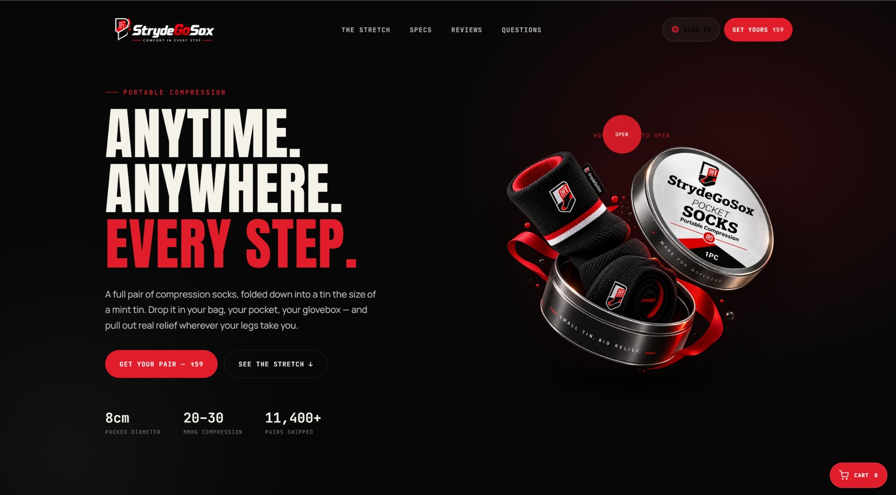
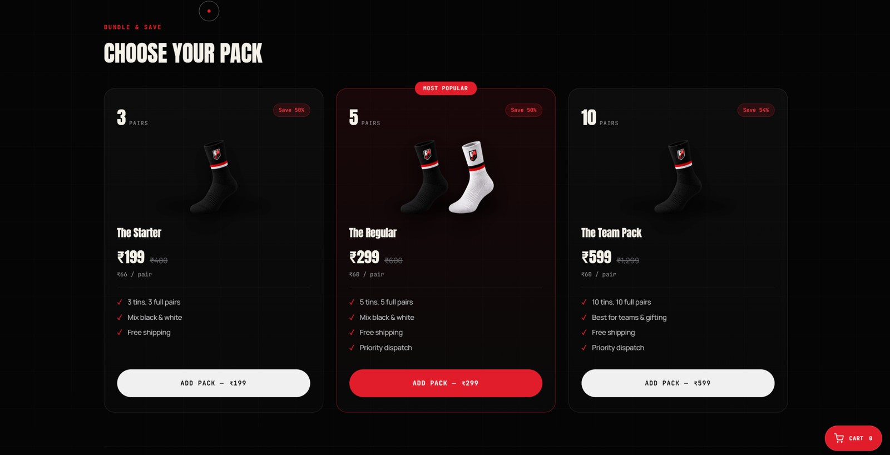
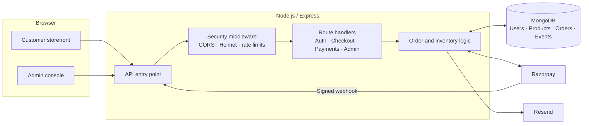

<div align="center">
  
  <h1>StrydeGoSox</h1>
  <p><strong>Client e-commerce platform · Storefront, payments and order operations</strong></p>
  <p>
    <a href="https://strydegosox.com">Live website</a>
    &nbsp;·&nbsp;
    <a href="docs/ARCHITECTURE.md">Architecture</a>
    &nbsp;·&nbsp;
    <a href="SECURITY.md">Security notes</a>
    &nbsp;·&nbsp;
    <a href="DEPLOYMENT-CHECKLIST.md">Deployment checklist</a>
  </p>
</div>

---

StrydeGoSox is a live commerce experience for a consumer product brand. The application connects product discovery, checkout, online and Cash on Delivery orders, payment reconciliation, inventory and day-to-day store operations.

## Product experience

| Product details | Bundle selection |
|:--:|:--:|
|  |  |

## What the platform includes

- **Storefront:** responsive product pages, product options, cart and checkout.
- **Payments:** Razorpay order creation, server-side payment verification and webhook handling.
- **Order integrity:** backend price calculation, idempotent checkout and inventory reservation/release.
- **Operations:** authenticated admin tools for products, stock, orders, fulfilment, COD and refunds.
- **Customer communication:** transactional order and status emails through Resend.

## Application architecture

The browser handles the customer and admin experiences. Business rules and trusted transaction decisions stay in the Express application; MongoDB stores commerce state, while payment and email providers integrate through backend services.



For the checkout sequence, inventory lifecycle, data entities and operational workflows, see the [architecture notes](docs/ARCHITECTURE.md).

## Engineering decisions

| Concern | Implementation |
|:--|:--|
| **Trusted pricing** | The backend recalculates totals from catalogue records instead of trusting browser-submitted prices. |
| **Payment confirmation** | Razorpay signatures and expected transaction values are checked server-side. |
| **Webhook retries** | Signed events are validated and tracked to reduce duplicate processing. |
| **Repeated checkout** | An idempotency key helps treat retried submissions as one intended checkout. |
| **Inventory consistency** | Stock is reserved, committed, released or restored as the order changes state. |
| **Admin access** | Protected routes use authentication and role checks. |

## Business activity

The client reported **70 orders in the first week** and **500+ orders in the first month** after launch. These are client-reported order counts, not independently audited revenue, conversion or profit figures.

## Technology

`HTML` `CSS` `JavaScript` `Node.js` `Express` `MongoDB` `Mongoose` `Razorpay` `Resend` `JWT` `bcryptjs` `Helmet`

## Repository layout

```text
admin/          Admin dashboard and operations UI
frontend/       Customer storefront
src/
  config/       Database connection
  middleware/   Authentication and access control
  models/       User, Product, Order and store-event models
  routes/       Public, auth, checkout, payment and admin APIs
  utils/        Order, Razorpay and email helpers
docs/           Architecture and product screenshots
```

## Run locally

**Requirements:** Node.js 20+, MongoDB, and Razorpay test credentials. Resend is optional for initial development.

1. Clone the repository and install dependencies:
   ```bash
   git clone https://github.com/varung4067-hash/strydegosox-ecommerce.git
   cd strydegosox-ecommerce
   npm ci
   ```
2. Copy `.env.example` to `.env` and provide local credentials. Never commit `.env`.
3. Start the application:
   ```bash
   npm run dev
   ```
4. To serve the storefront and admin UI from Express, use:
   ```bash
   npm start
   ```

Useful checks: `npm run check` and `npm run qa`.

> **Media note:** this public repository includes the approved product screenshots shown above. The full optimised product-media bundle used by the live deployment is not included, so a local clone may not reproduce every live storefront image.

## Security and deployment

Use the [security notes](SECURITY.md) and [deployment checklist](DEPLOYMENT-CHECKLIST.md) before configuring a new environment. Keep database, JWT, Razorpay and Resend credentials in private environment variables. Use test payment credentials during local development.

---

<div align="center">
  <sub>Built with a focus on a clear shopping experience and dependable order workflows.</sub>
</div>