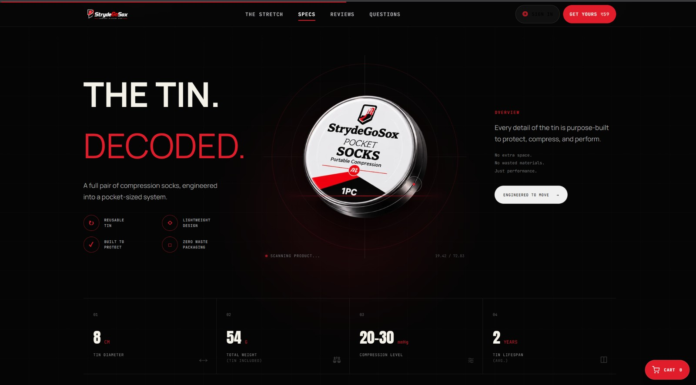
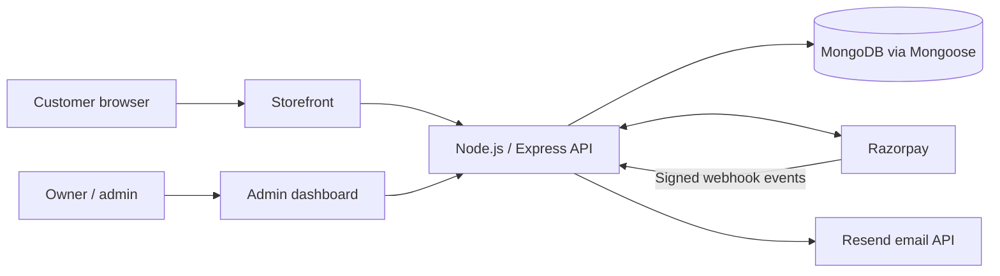
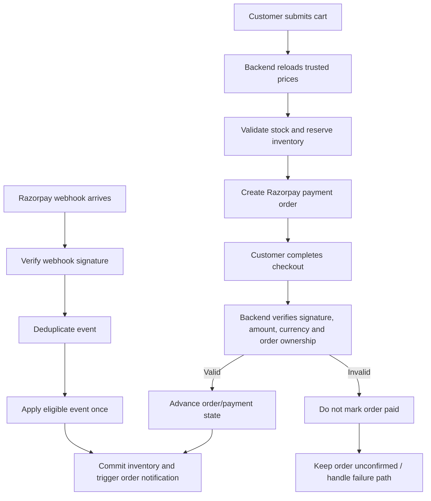
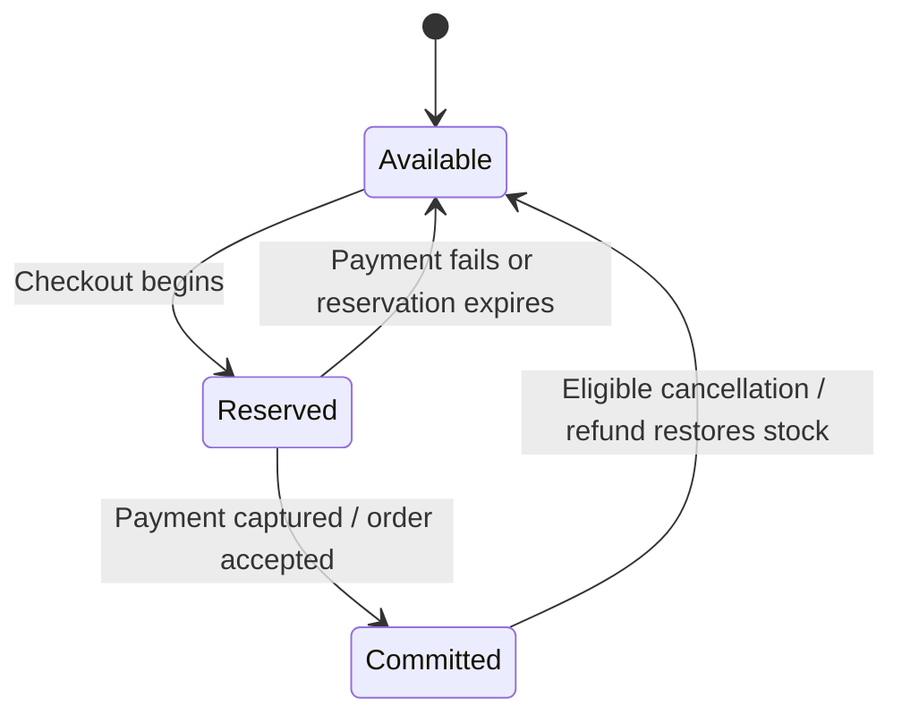

<div align="center">
  
  <h1>StrydeGoSox</h1>
  <p><strong>Full-stack e-commerce storefront · Secure checkout · Admin operations</strong></p>
  <p>
    <a href="https://strydegosox.com">Live website</a>
    &nbsp;·&nbsp;
    <a href="#architecture">Architecture</a>
    &nbsp;·&nbsp;
    <a href="#security-and-order-integrity">Security</a>
  </p>
  
  
  
  
</div>

---

## Project overview

StrydeGoSox is a branded e-commerce experience for pocket compression socks. The application brings together a customer storefront, persistent cart, checkout, payment processing, order history and an owner-facing admin workspace for catalogue, inventory and fulfilment operations.

The engineering focus was not limited to the storefront UI. The backend owns important commerce decisions—pricing, payment-state verification, inventory reservations, order-state changes and privileged admin actions—so that the browser is not treated as a trusted source of truth.

## Product experience

### Storefront hero

The hero section introduces the product proposition: a full pair of compression socks folded into a pocket-sized tin, supported by a prominent product visual and clear purchase path.

### Product specifications



### Bundle and pack selection


## Core capabilities

| Area | Implemented capability |
|:--|:--|
| **Storefront** | Responsive product storytelling, product details, cart, quantity controls and checkout entry point. |
| **Cart & checkout** | Persistent cart and backend checkout validation using authoritative catalogue data. |
| **Payments** | Razorpay Standard Checkout, server-side signature verification and webhook processing. |
| **Cash on delivery** | COD order creation and owner-side collection/fulfilment lifecycle. |
| **Inventory** | Stock validation, pending-payment reservations, commit/release handling and refund-related restoration. |
| **Admin workspace** | Product catalogue, inventory adjustments, order search/filter, status updates and fulfilment tracking. |
| **Refunds** | Refund workflow for eligible captured Razorpay payments, with reconciliation and inventory restoration safeguards. |
| **Notifications** | Transactional order/status emails through Resend, with idempotency safeguards for supported operations. |
| **Operations** | CSV export, health/readiness endpoint, request IDs and server-side logging. |

## Architecture

<a id="architecture"></a>



The frontend and admin UI call the backend API. The backend coordinates persisted catalogue/order state, payment provider interactions and transactional email. Payment and inventory decisions remain server-side.

## Security and order integrity

<a id="security-and-order-integrity"></a>

Checkout and order processing include several layers of protection designed to reduce tampering, duplicate processing and inconsistent commerce state.

| Risk | Safeguard | Why it matters |
|:--|:--|:--|
| Browser-side price manipulation | Checkout recalculates prices from database product records. | Prevents a submitted browser total from becoming the trusted order amount. |
| Forged or mismatched online payment | Razorpay signature verification plus expected amount, currency and order-ownership checks. | Prevents a browser success response by itself from confirming an online order as paid. |
| Forged gateway notification | Webhook signature verification using the raw request body and configured webhook secret. | Helps authenticate incoming payment events before the application acts on them. |
| Duplicate webhook delivery | Event tracking using Razorpay event IDs, deterministic fallback identifiers and database uniqueness protection. | Reduces repeated side effects when the gateway retries or redelivers an event. |
| Repeated checkout submission | Checkout idempotency through an `Idempotency-Key`. | Reduces accidental duplicate order creation from repeated clicks or request retries. |
| Stock overselling / drift | Server-side availability checks and transaction-aware reserve, commit, release and restoration flows. | Keeps inventory aligned with pending, captured, failed, expired and refunded order states. |
| Conflicting refund requests | Refund concurrency protection and payment reconciliation. | Helps avoid competing refund operations and inconsistent stock restoration. |
| Unauthorised admin access | JWT authentication, role enforcement, bcrypt password hashing and HTTP-only session cookies. | Protects privileged product, inventory and order operations. |
| Common request abuse | Helmet/CSP, restricted CORS, rate limits, input validation and no-store handling for sensitive responses. | Adds defence-in-depth around public APIs and authenticated admin surfaces. |
| Duplicate notification side effects | Backend-triggered transactional email with idempotency on supported operations. | Reduces repeated confirmation/status notifications on retries. |

### Online-payment lifecycle



### Inventory lifecycle



**Security impact:** these controls reduce opportunities for price tampering, forged payment confirmation, duplicate checkout creation, replayed webhook side effects and inventory inconsistency. They strengthen order integrity, but they are not a guarantee against all fraud. A specific fraud-prevention percentage has not been measured from production event data. COD non-acceptance/no-show risk is separate from Razorpay payment verification.

## Business activity

The client reported **70 orders in the first week** and **500+ orders in the first month** after launch. These are client-reported order counts, not independently audited conversion, revenue or profit uplift figures.

## Technology stack

- **Frontend:** HTML5, CSS3, JavaScript
- **Backend:** Node.js, Express.js, REST APIs
- **Database:** MongoDB, Mongoose
- **Payments:** Razorpay
- **Email:** Resend
- **Security & middleware:** JWT, bcryptjs, Helmet, CSP, CORS, express-rate-limit, HTTP-only cookies
- **Operations:** request IDs, logging, health/readiness checks, CSV export

## Repository layout

```text
admin/              Owner dashboard and admin-side scripts/assets
frontend/           Customer storefront, styles, scripts and assets
src/config/         Database connection
src/middleware/     Authentication and request middleware
src/models/         User, product, order, settings and webhook models
src/routes/         Auth, checkout, payment, admin, COD and refund routes
src/utils/          Order, Razorpay and email utilities
docs/screenshots/   Project screenshots used in this README
seed.js             Initial product catalogue seed script
production-qa.js    Static/source-level QA checks
```

## Run locally

### Requirements

- Node.js 20 or newer
- MongoDB instance (MongoDB Atlas or local MongoDB)
- Razorpay test credentials for payment-flow testing
- Resend API key and a configured sender for email testing (optional during initial UI work)

### Setup

1. Clone the repository and open the project root.
2. Install dependencies:

   ```bash
   npm install
   ```

3. Create your private environment file from the template:

   ```bash
   cp .env.example .env
   ```

4. Fill in the database, JWT, admin, Razorpay and email values in `.env`. Do not commit this file.
5. Start the API:

   ```bash
   npm run dev
   ```

6. Serve `frontend/` and `admin/` with VS Code Live Server. For the default local configuration, use port `5501` and open `http://127.0.0.1:5501/frontend/index.html`.
7. Open the admin page at `http://127.0.0.1:5501/admin/admin.html`.
8. Optionally seed the initial catalogue from the project root:

   ```bash
   npm run seed
   ```

The backend defaults to port `5000`. Keep the local frontend/admin origins aligned with the values in `.env` and the allowed development origins in the server configuration.

### Useful commands

```bash
npm run dev     # Start the API in development mode
npm start       # Start the app with frontend serving enabled
npm run seed    # Seed/update initial product metadata
npm run check   # Run JavaScript syntax checks
npm run qa      # Run source-level QA checks
```

## Deployment and verification notes

The repository includes `DEPLOYMENT-CHECKLIST.md` for environment, payment, inventory, refund and security checks. Before live operation, configure the production domain, HTTPS, restricted database user, backups, live Razorpay keys/webhook, verified email sender and private environment secrets; then test successful/failed payments, duplicate checkout, webhook retries, COD, cancellations, refunds and inventory restoration end to end.

This repository is an implementation and portfolio case study, not a penetration-test report, security certification or independent production-readiness attestation. Production behavior depends on the live environment and operational configuration.

## Project media

The screenshots in `docs/screenshots/` are supplied project reference captures. The first image is the storefront hero; the following images show product specifications and bundle selection.
