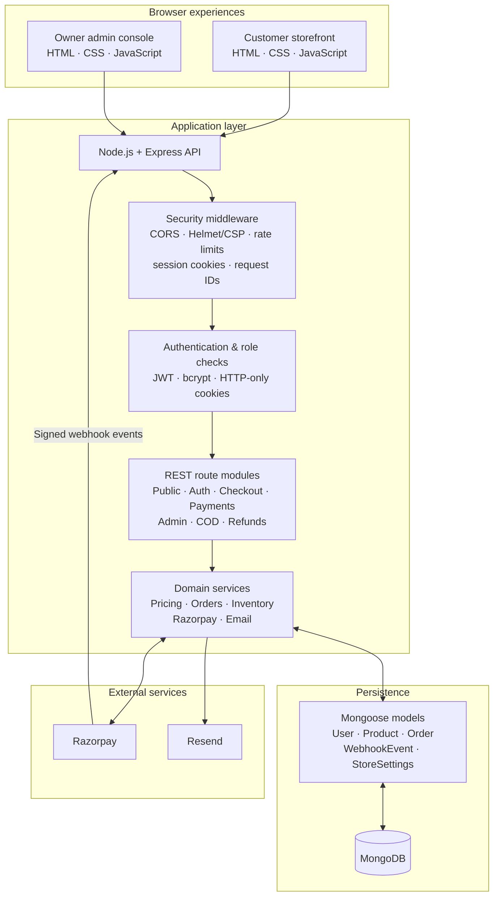
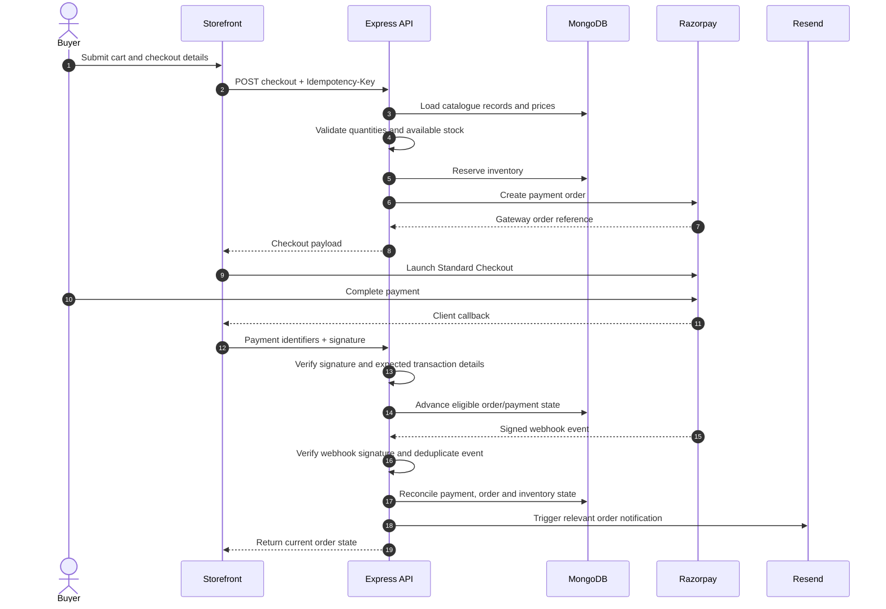
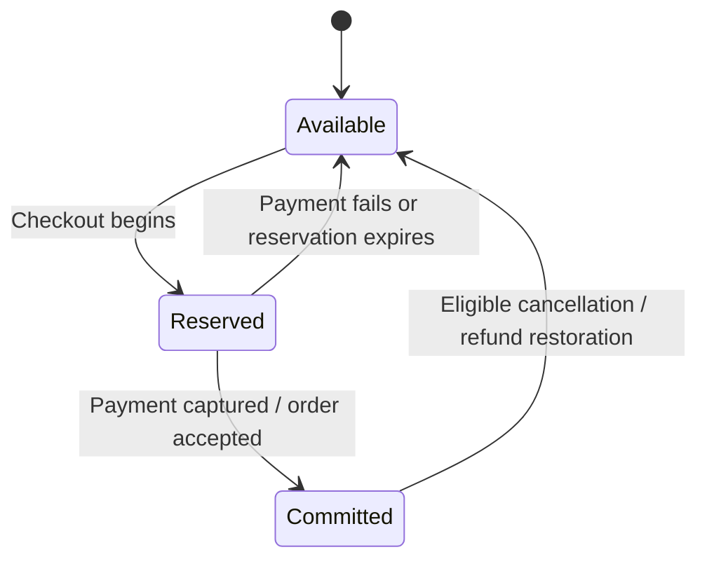
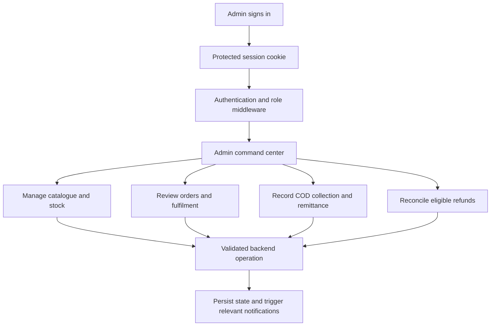
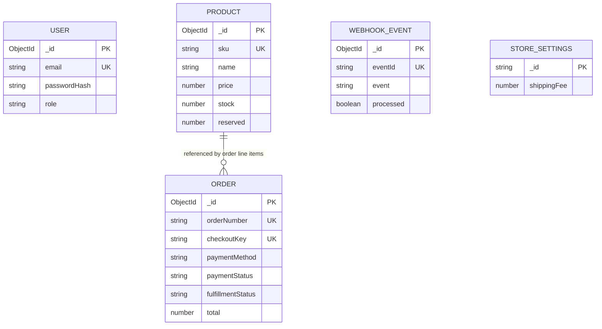

<!-- StrydeGoSox portfolio case study. Do not add .env files, live credentials or customer records. -->
<div align="center">
  
  <h1>STRYDEGOSOX</h1>
  <p><strong>Full-stack commerce · Payment integrity · Inventory operations</strong></p>
  <p>
    <a href="https://strydegosox.com">Live storefront ↗</a>
    &nbsp;·&nbsp;
    <a href="docs/ARCHITECTURE.md">System architecture ↗</a>
    &nbsp;·&nbsp;
    <a href="#security-and-order-integrity">Security engineering</a>
  </p>
  
  
  
  
  
</div>

---

## Project overview

StrydeGoSox is a client e-commerce platform for pocket compression socks. It brings together a customer storefront, persistent shopping cart, checkout, Razorpay payments, cash-on-delivery (COD) handling and an owner-facing admin workspace for catalogue, inventory, orders, refunds and fulfilment.

The engineering challenge was to make the purchase lifecycle dependable—not just visually complete. Product pricing, payment state, stock availability and privileged admin operations are validated and coordinated by the backend rather than trusted from browser-submitted data.

| Project detail | Summary |
|:--|:--|
| **Project type** | Client e-commerce application |
| **Live product** | [strydegosox.com](https://strydegosox.com) |
| **Application** | Customer storefront · Admin console · REST API |
| **Backend / data** | Node.js · Express · MongoDB · Mongoose |
| **Commerce integrations** | Razorpay · Resend |
| **Local source QA** | 44/44 checks passed in the prepared project package |

### Business activity reported by the client

<div align="center">
<table>
<tr>
<td align="center" width="50%"><h2>70</h2><strong>Orders in the first week</strong><br/><sub>Client-reported after launch</sub></td>
<td align="center" width="50%"><h2>500+</h2><strong>Orders in the first month</strong><br/><sub>Client-reported after launch</sub></td>
</tr>
</table>
</div>

<sub>These are order counts shared by the client, not independently audited conversion-rate, revenue or profit uplift figures.</sub>

## Product experience

### 01 — Storefront hero
The hero introduces the product proposition: a pair of compression socks packed into a portable tin, with a direct path into product discovery and purchase.

### 02 — Product specifications


### 03 — Bundle selection


## What I delivered

| Product area | Implementation |
|:--|:--|
| **Customer storefront** | Responsive product storytelling, product detail sections, mission-led content, product visuals and purchase paths. |
| **Shopping cart** | Persistent cart state, quantity controls and item removal. |
| **Checkout** | Server-authoritative cart pricing, stock validation and checkout idempotency. |
| **Online payments** | Razorpay order creation, signature verification, amount/currency/order checks and signed webhook processing. |
| **Cash on delivery** | COD order workflow, collection tracking, failed-delivery handling and remittance management. |
| **Inventory** | Stock availability, pending-payment reservations, commit/release logic and refund-related restoration. |
| **Admin workspace** | Product management, stock adjustments, order search/filter, status changes, shipping/tracking and operational views. |
| **Refunds** | Eligible captured-payment refunds, concurrency safeguards, reconciliation and inventory restoration. |
| **Notifications** | Transactional order/status emails through Resend with idempotency safeguards for supported operations. |
| **Operations** | CSV exports, health/readiness endpoints, request IDs and server-side logging. |

<a id="system-architecture"></a>
## System architecture

The storefront and admin console are separate browser experiences. Both call the Node.js / Express API, which applies validation and business rules, persists commerce state through Mongoose, and coordinates payment and email providers.



### Component responsibilities

| Component | Responsibility |
|:--|:--|
| **Storefront** | Product discovery, cart interactions, checkout inputs and customer-facing order experience. |
| **Admin console** | Authenticated catalogue, inventory, order, COD, refund and fulfilment operations. |
| **Express API** | Request validation, route handling, authentication and application business rules. |
| **Mongoose models** | User/product/order state, schema validation and database indexes. |
| **Razorpay** | Online payment order creation, checkout and payment event notifications. |
| **Resend** | Transactional email delivery initiated by backend order events. |

## Checkout and payment lifecycle

The browser starts checkout, but the server rebuilds the payable amount using trusted catalogue records. Online orders are not considered paid solely because the browser displays a success screen.



## Inventory and order-state consistency

Inventory is part of the checkout lifecycle, not just a number shown on the product card.



The application includes stock reservations, commit/release handling, expiry cleanup and refund/restock safeguards. Production behaviour still depends on configuration and end-to-end validation of concurrency and failure paths.

## Security and order integrity

The security work focuses on high-risk points in the purchase lifecycle: client-submitted prices, payment confirmation, webhook authenticity, repeated requests, inventory consistency and privileged admin operations.

| Risk | Application safeguard | Practical business value |
|:--|:--|:--|
| **Price tampering** | Checkout rebuilds prices from database product records. | A browser-submitted total is not treated as the trusted payable amount. |
| **Forged payment-success response** | Razorpay checkout-signature verification plus expected amount, currency and order-ownership checks. | A client-side success screen alone cannot mark an online order as paid. |
| **Forged webhook** | Signature verification using the raw request body and configured webhook secret. | Helps authenticate provider notifications before processing them. |
| **Repeated webhook delivery** | Event ID tracking, deterministic fallback identifiers and database uniqueness protection. | Reduces duplicate side effects when a provider retries or redelivers an event. |
| **Double-click / checkout retry** | Checkout idempotency through an `Idempotency-Key`. | Reduces accidental duplicate order creation from repeat submissions of the same request. |
| **Stock overselling / drift** | Server-side availability checks and reserve, commit, release and restore operations. | Keeps stock aligned with pending, captured, failed, expired and refunded order states. |
| **Competing refund requests** | Refund concurrency protection and payment reconciliation. | Helps avoid conflicting refund operations and inconsistent stock restoration. |
| **Unauthorised admin actions** | JWT authentication, role enforcement, bcrypt password hashing and HTTP-only session cookies. | Protects privileged product, inventory and order operations. |
| **Common request abuse** | Helmet/CSP, restricted CORS, rate limits, input validation and no-store controls for sensitive responses. | Adds defence-in-depth around public APIs and authenticated admin surfaces. |
| **Repeated email side effects** | Backend-triggered transactional email with idempotency safeguards for supported operations. | Reduces duplicate notification sends on supported retry paths. |

### Security impact

These layered controls reduce opportunities for price tampering, forged payment confirmation, accidental duplicate checkout creation, replayed webhook side effects and inventory inconsistency. The project does not have production telemetry establishing a specific percentage of fraudulent orders prevented, so no such percentage is claimed. COD non-acceptance/no-show risk is separate from online-payment verification.

## Admin and fulfilment workflow



## Data model overview



Order line items retain product references and snapshots of SKU, product name, unit price and quantity so catalogue edits do not rewrite order history.

## Technology stack

| Area | Tools |
|:--|:--|
| **Frontend** | HTML5, CSS3, JavaScript |
| **Backend** | Node.js 20+, Express.js, REST API modules |
| **Database** | MongoDB, Mongoose |
| **Payments** | Razorpay Standard Checkout and webhooks |
| **Email** | Resend transactional email API |
| **Authentication** | JWT, bcryptjs, HTTP-only cookies, role middleware |
| **Application security** | Helmet, CSP, CORS restrictions, express-rate-limit, request validation |
| **Quality checks** | Node syntax checks and custom source-level QA script |

## Repository structure

```text
admin/
  admin.html
  js/                   Admin dashboard, COD and refund modules
frontend/
  index.html
  assets/               Storefront imagery and product assets
  js/                   Storefront logic and API configuration
  main.js
  style.css
src/
  config/               MongoDB connection
  middleware/           Authentication and access control
  models/               User, Product, Order, StoreSettings, WebhookEvent
  routes/               Public, Auth, Checkout, Payments, Admin, COD, Refunds
  utils/                Order, Razorpay and email services
docs/
  screenshots/          Product and storefront screenshots
  ARCHITECTURE.md       Extended system and workflow diagrams
.env.example            Safe placeholder configuration
SECURITY.md             Security and credential-handling notes
DEPLOYMENT-CHECKLIST.md Production configuration and go-live checks
production-qa.js        Source-level QA checks
seed.js                 Initial catalogue seeding
package.json            Scripts and dependencies
```

## Run locally

### Prerequisites
- Node.js 20 or newer
- MongoDB instance (local or MongoDB Atlas)
- Razorpay test credentials for payment-flow testing
- Resend API key and a verified sender for email testing (optional for initial UI work)

### Setup

1. Clone the repository:
   ```bash
   git clone https://github.com/varung4067-hash/strydegosox-ecommerce.git
   cd strydegosox-ecommerce
   ```
2. Install dependencies: `npm install`
3. Create a private environment file: `cp .env.example .env`
4. Fill local MongoDB, JWT, admin, Razorpay test and optional Resend values. Never commit `.env`.
5. Start the API: `npm run dev`
6. Serve the `frontend/` and `admin/` directories with a local static server. The default local setup expects port `5501`; storefront: `http://127.0.0.1:5501/frontend/index.html`; admin: `http://127.0.0.1:5501/admin/admin.html`.
7. Optionally seed the initial catalogue: `npm run seed`

The API defaults to port `5000`. Keep browser origins aligned with the values in your private `.env` and the backend's allowed development origins.

### Useful commands

```bash
npm run dev     # Start API in development mode
npm start       # Start with frontend serving enabled
npm run seed    # Seed/update initial product metadata
npm run check   # Run JavaScript syntax checks
npm run qa      # Run syntax checks and source-level QA suite
```

## Quality and verification

The included source-level QA script checks important implementation invariants such as:

- Razorpay raw-body webhook signature handling.
- Checkout idempotency and server-side order creation.
- Amount, currency and order verification before payment-state changes.
- Webhook event deduplication and retry-safe failure handling.
- Authenticated admin routes and protected session handling.
- Inventory reserve/release/commit operations and refund reconciliation.
- Exclusion of production `.env` files and live-looking secrets from the inspected source.

**Latest local source-level run:** 44/44 checks passed in the prepared local package. This is not an independent penetration test, live payment certification or substitute for production end-to-end testing.

## Deployment notes

See [`DEPLOYMENT-CHECKLIST.md`](DEPLOYMENT-CHECKLIST.md) before deploying. Production operation requires HTTPS, private environment secrets, restricted MongoDB access, backups, a verified email sender, Razorpay live keys/webhook and end-to-end testing of successful and failed payments, retries, COD, refunds and inventory restoration.

---

<div align="center"><sub>Built for a real commerce workflow, with attention to user experience, transaction integrity and operational clarity.</sub></div>
