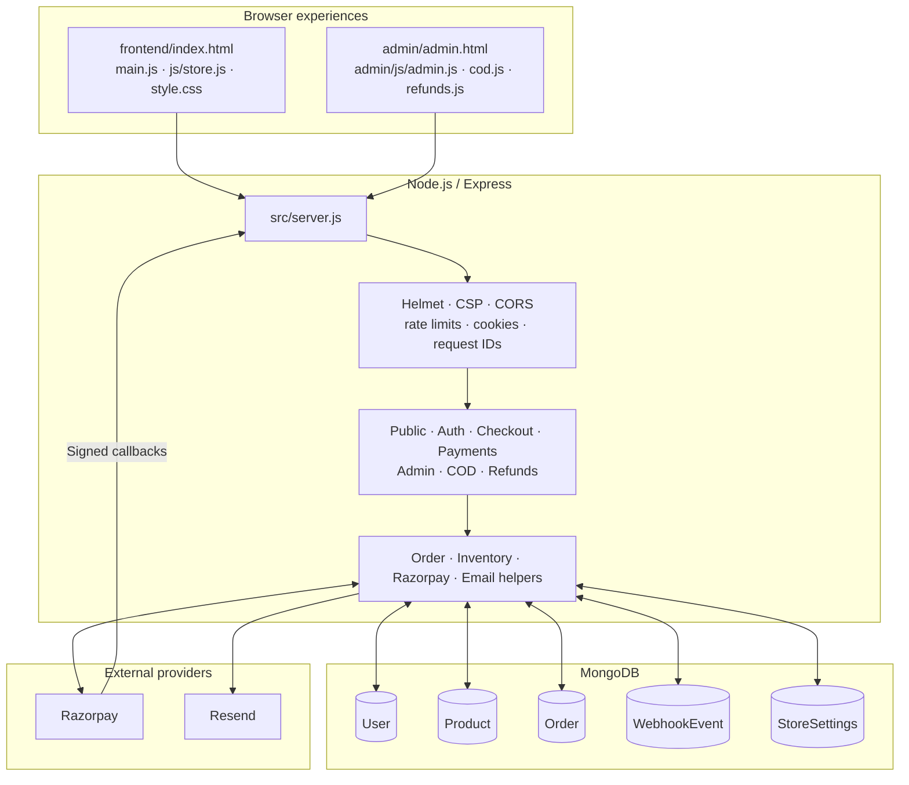
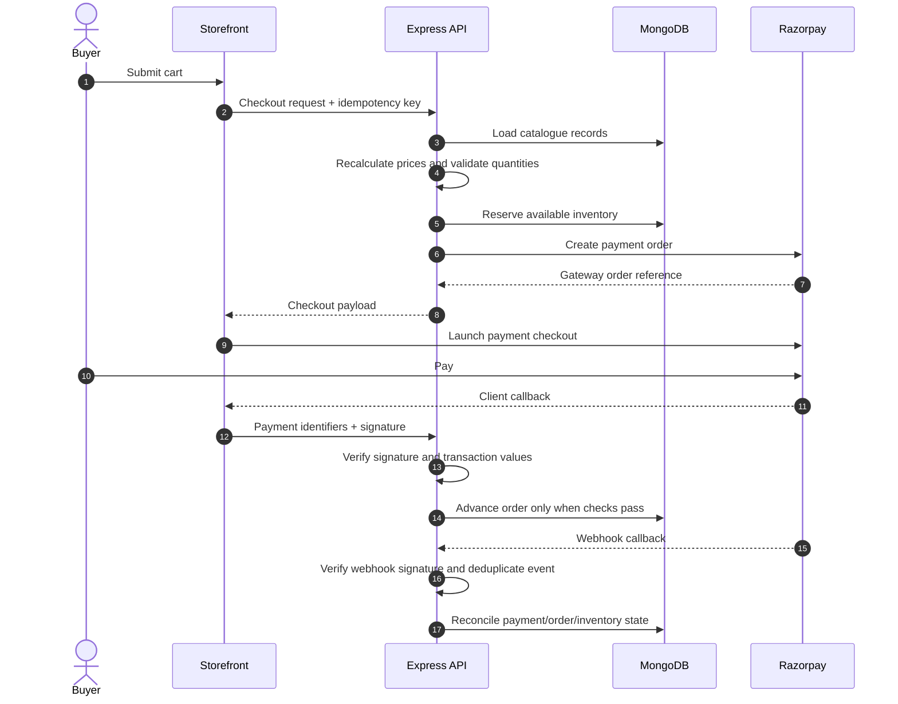
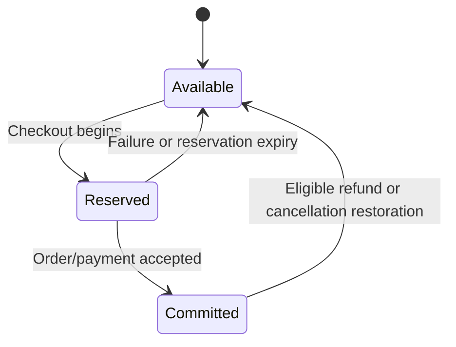
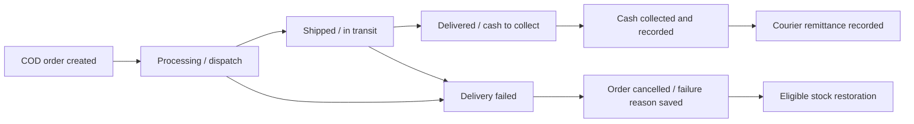
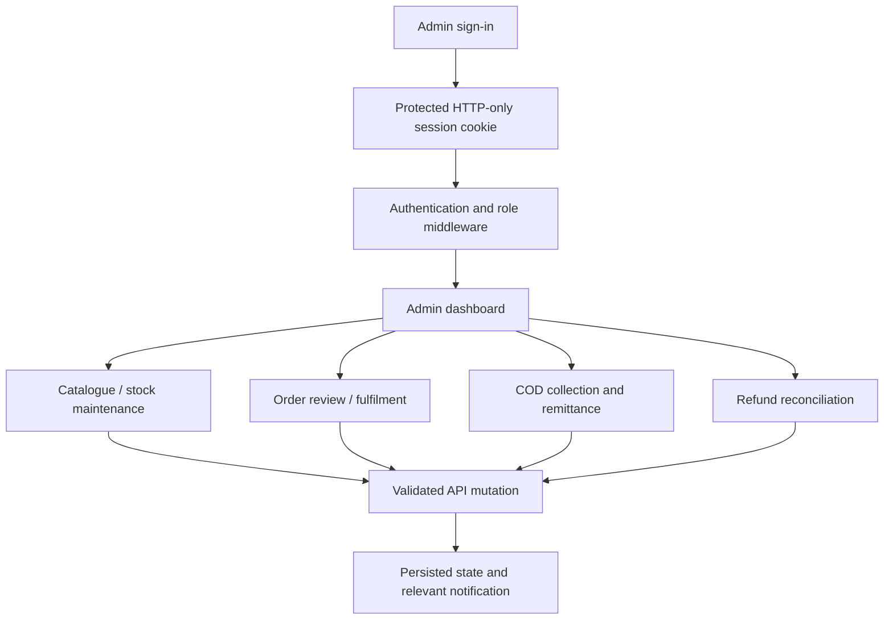
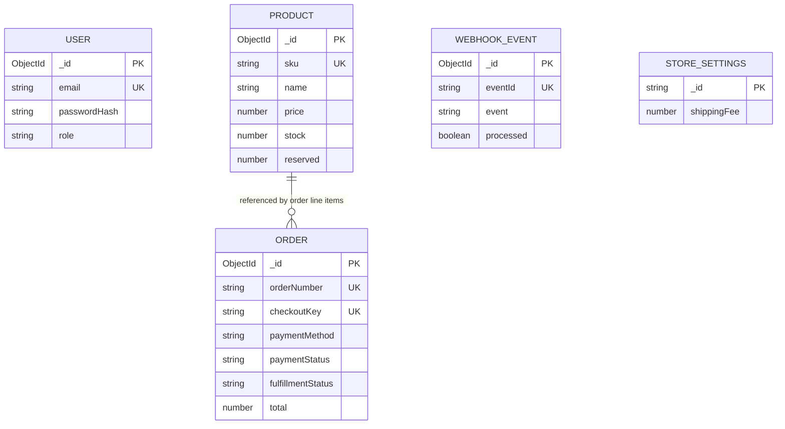

# StrydeGoSox — Architecture and workflow notes

This document expands the diagrams in the main repository README and describes how the browser experience, backend application, persisted commerce data and external providers fit together.

## 1. Runtime architecture

## 2. Route responsibilities

| Route area | Responsibility |
|:--|:--|
| `public` | Public catalogue and store settings. |
| `auth` | Sign-in, session and account authentication. |
| `checkout` | Server-side cart repricing, checkout idempotency and stock reservation. |
| `payments` | Razorpay order creation, signature verification, webhooks and payment-state processing. |
| `admin` | Authenticated catalogue, inventory and order operations. |
| `cod` | Cash collection, failed-delivery and remittance workflow. |
| `refunds` | Eligible payment refunds, reconciliation and stock-restoration handling. |

## 3. Online checkout sequence

## 4. Inventory state model

## 5. Cash-on-delivery lifecycle

COD collection and remittance are separate operational events. Online payment verification does not determine whether a COD recipient will accept a parcel.

## 6. Admin lifecycle

## 7. Data entities

Order line items retain a product reference and a snapshot of SKU, product name, unit price and quantity. This lets order history retain the purchased details when the catalogue changes later.

## 8. Trust boundaries and safeguards

- The browser is an input surface, not the source of truth for final prices, payment status or inventory availability.
- Payment and webhook signatures are validated on the backend using server-side secrets.
- Repeated checkout submissions use an idempotency key; webhook events are tracked to reduce duplicate side effects.
- Admin routes apply authentication and role checks; protected session tokens are carried in HTTP-only cookies.
- Database and provider secrets belong in private environment configuration, never in frontend bundles or version control.

These are application-level controls. Effective production protection also depends on correct live configuration, secret rotation, database permissions, backups, monitoring and end-to-end operational tests.
